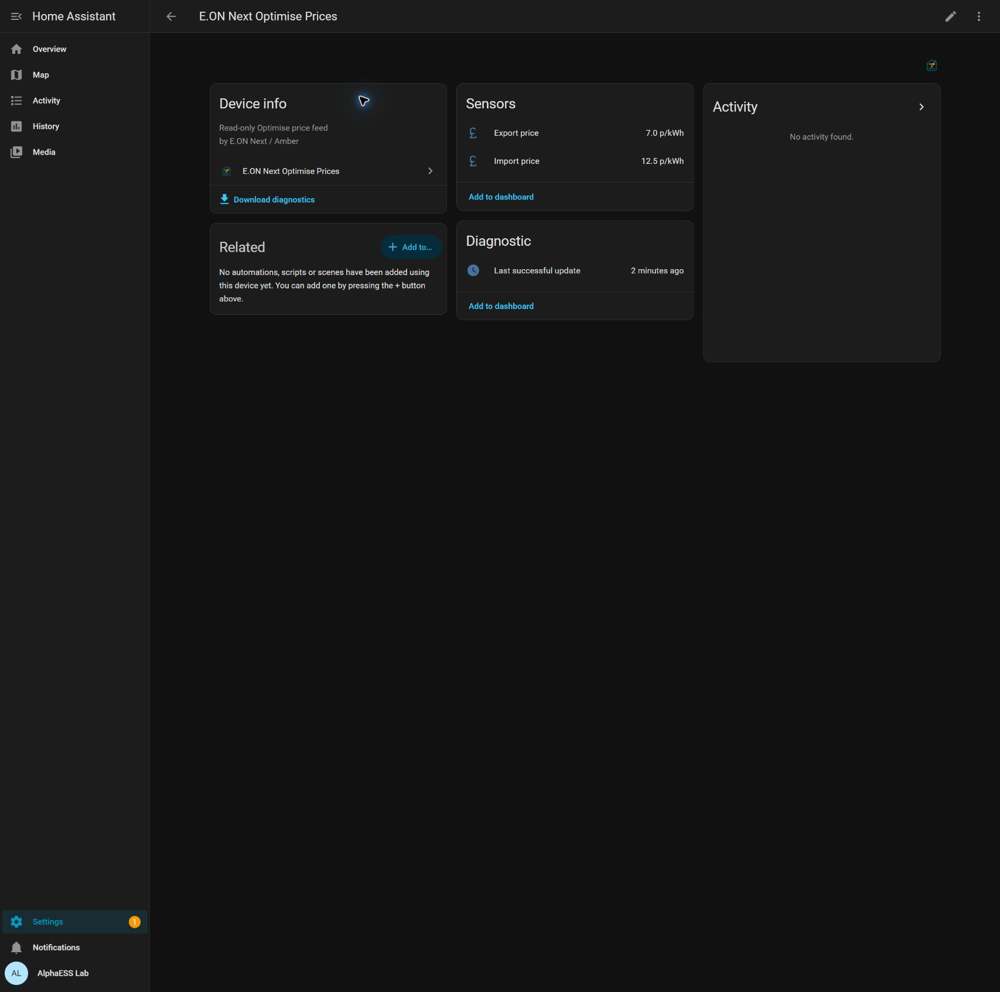

# E.ON Next Optimise Prices


A small, unofficial Home Assistant integration that translates **your own Optimise app price feed** into sensors on one device. Enter your Optimise app email and password; no API key or Predbat installation is needed.

> Release candidate: prepared for review. The proposed public repository and HACS installation link are not live yet.

## One device, three sensors

All sensors belong to **E.ON Next Optimise Prices** in Settings → Devices & services.



*Test-device preview using synthetic demonstration prices, not the author's account prices.*

| Sensor | What it shows |
| --- | --- |
| Import price | The API price for the current half-hour, in p/kWh |
| Export price | The API export earning rate for the current half-hour, in p/kWh |
| Last successful update | When a valid import and export feed was last received |

Positive export prices mean payment for export; negative export prices mean a cost. Zero and negative prices are preserved.

The two price sensors include a `rates` attribute containing the API's timestamped previous, current and upcoming periods. Upcoming periods are supplied by E.ON/Amber and can change. **There are no custom forecasts, trained models, personal prices, booster assumptions or local-server dependencies.**

This integration only reads price data. It creates no switches, battery commands or SmartShift controls. It can coexist with the standard E.ON Next integration, your battery integration and SmartShift.

## Requirements

- Home Assistant **2026.3 or later**, for the bundled integration picture. Tested on 2026.10.1.
- HACS, if using the HACS installation route.
- An active E.ON Next Optimise app account that can display both import and export prices.
- Internet access from Home Assistant to the Optimise app's authentication and price services.

Use the credentials you use in the **Optimise app**. These may differ from your standard E.ON Next online-account login. The integration cannot enrol an account, activate export or complete an interactive MFA challenge.

## Install with HACS

Once this release has been published:

1. Open **HACS → ⋮ → Custom repositories**.
2. Add `https://github.com/markgraham924/ha-eon-optimise-prices` with category **Integration**.
3. Download **E.ON Next Optimise Prices**.
4. Restart Home Assistant.
5. Open **Settings → Devices & services → Add integration** and search for **E.ON Next Optimise Prices**.
6. Enter your **Optimise app email and password**.

After validation, Home Assistant creates one device containing all three sensors. Keep your battery-control setup as it is.

This is a HACS **custom repository**; inclusion in HACS's default catalogue has not been requested or approved.

## Manual installation

1. From the release ZIP, copy `custom_components/eon_next_optimise` into your Home Assistant `config/custom_components` directory.
2. Restart Home Assistant.
3. Add **E.ON Next Optimise Prices** from Devices & services and enter your Optimise app login.

The folder must be `config/custom_components/eon_next_optimise/manifest.json`, not an extra nested copy of the repository.

The domain is separate from the earlier private `eon_optimise_forecast` experiment. Installing this package does not replace it. If you already run that private experiment, choose one price poller when evaluating this release.

## Add prices to a dashboard

The default entity IDs for a first installation are:

- `sensor.e_on_next_optimise_prices_import_price`
- `sensor.e_on_next_optimise_prices_export_price`
- `sensor.e_on_next_optimise_prices_last_successful_update`

Home Assistant may add a suffix if those names already exist. Select the actual entities from the device page.

A native Entities card is enough:

```yaml
type: entities
title: Optimise prices
entities:
  - entity: sensor.e_on_next_optimise_prices_import_price
    name: Import
  - entity: sensor.e_on_next_optimise_prices_export_price
    name: Export
  - entity: sensor.e_on_next_optimise_prices_last_successful_update
    name: Last updated
```

No custom dashboard card is required. Dashboard integrations that draw upcoming prices can use the timestamped `rates` attribute.

## Rates, freshness and earnings

Prices are fetched every five minutes, once per configured account. Current prices advance at minute boundaries using the applicable half-hour interval, without issuing another API request each minute.

A failed refresh, missing current interval or feed older than 15 minutes makes the price sensors **unavailable**. Old prices are not carried into uncovered intervals. Last successful update remains visible to help diagnose freshness.

Each rate row contains:

- `valid_from` and `valid_to`: timezone-aware timestamps; the end is exclusive.
- `value_inc_vat`: the API price normalised to pence per kWh. The field name is retained for compatibility with existing rate consumers; no tax or account-specific adjustment is added.
- `source_quality`: `history`, `current` or `forecast`, matching the source API period group.
- `provider_estimate`: the supplier's estimate flag, when supplied.

`covered_until` means contiguous data coverage, not a guaranteed tariff. Upcoming prices are not settlement rates.

For an earnings estimate, match each half-hour's exported kWh to that period's delivered rate:

`estimated pounds = sum(half-hour exported kWh × that half-hour's p/kWh ÷ 100)`

Multiplying an entire day's export by the current price gives an inaccurate result on a varying tariff. This integration does not calculate billing totals; your supplier's bill remains authoritative. If a Home Assistant cost input expects GBP/kWh, convert the p/kWh sensor by dividing by 100 and preserve its availability.

## Privacy and authentication

Credentials and refresh tokens are stored in Home Assistant's private config-entry storage. They are sent only to the app's authentication and price services. Do not publish your config entries or backups.

Sensors and diagnostics expose no email, password, token, site ID or meter ID. Diagnostic downloads include only feed health, timestamps and period counts. Passwords are masked in the setup form. Revoked sessions attempt one fresh login; rejected credentials trigger Home Assistant's reauthentication flow.

The API is the Optimise app's authenticated, Amber-backed interface. This is an unofficial community integration, not an E.ON, Amber, Home Assistant or HACS product, and upstream app/API changes may require an update.

## Troubleshooting

- **Login rejected:** verify the same login in the Optimise app. Complete any verification there, then retry. Interactive MFA challenges are not implemented.
- **No valid price feed:** confirm the app shows both import and export prices. Newly activated accounts may not have both channels yet.
- **Prices unavailable:** check Last successful update, the app and Home Assistant's network access. No fallback prices are invented.
- **Picture missing:** the included picture uses Home Assistant's local branding support introduced in 2026.3.
- **Support:** attach the integration's redacted diagnostic download and describe the issue. Do not attach credentials, full config entries or raw API responses.

## Development

The integration is sensor-only. Tests cover price normalisation, interval boundaries, negative/zero rates, API retries/redaction, configuration, reauthentication, outages, device grouping and unload.

Use Python 3.14 on Linux for the current Home Assistant test harness:

```sh
pip install -r requirements-dev.txt pycognito==2024.5.1
pytest -q
ruff check .
ruff format --check .
```

See [release checks](docs/release-checks.md) for the candidate's validation evidence and publication steps.

## Licence

MIT. The original project icon is included with the source licence. It does not reproduce the providers' official logos.
